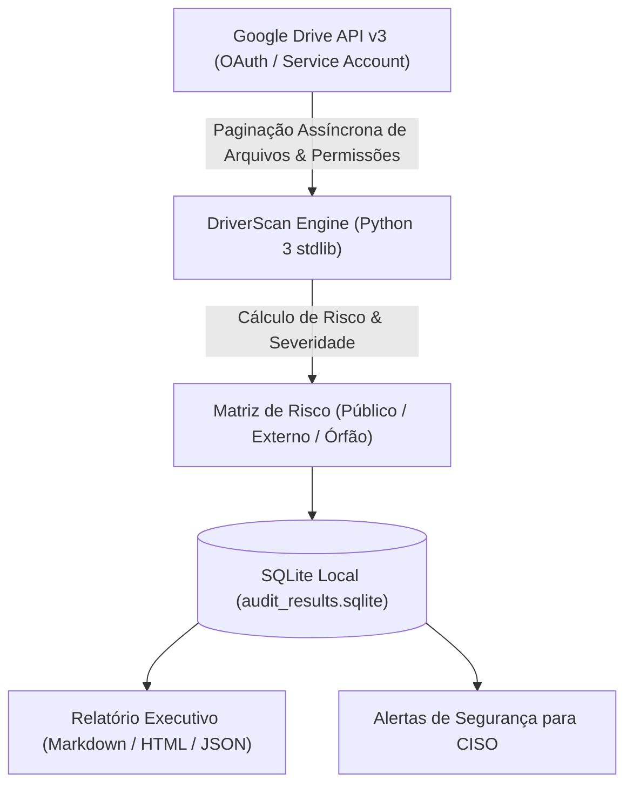

# 🔍 DriverScan Workspace Audit CLI
## Ferramenta CLI de Alta Performance para Auditoria e Governança de Permissões no Google Drive Corporativo


[](https://techdimbr.github.io/techdimbr/)
[](https://www.techdim.com.br)
[-3776AB.svg)](https://www.python.org)
[](https://www.sqlite.org)
[](README.md)
[](LICENSE)

> **Auditoria instantânea de links públicos órfãos, compartilhamentos externos descontrolados e permissões excessivas em Shared Drives e Meu Drive empresarial. Zero dependências externas pesadas, banco de dados local SQLite e relatórios de risco para C-Levels.**

---

## 🏛️ Visão Geral & Proposta de Valor

Em ambientes corporativos com centenas de colaboradores, o Google Drive acumula silenciosamente milhares de documentos confidenciais compartilhados com o link público aberto (`anyoneWithLink`) ou vinculados a e-mails pessoais de ex-funcionários.

O **DriverScan Workspace Audit CLI** resolve esse ponto cego com extrema velocidade e discrição:
1. **Detecção Cirúrgica de Riscos:** Identifica arquivos com permissões públicas de leitura ou escrita sem autenticação.
2. **Arquitetura Zero Bloatware:** Construído utilizando exclusivamente a biblioteca padrão do Python 3 (`urllib`, `sqlite3`, `json`), operando sem risco de conflito de dependências.
3. **Persistência Estruturada:** Indexa metadados e permissões em banco SQLite local criptografado, permitindo consultas SQL avançadas e relatórios comparativos de conformidade.

---

## 🏗️ Fluxo Operacional do Scanner



---

## ⚡ Início Rápido

### Execução da Auditoria
```bash
# 1. Clonar o repositório
git clone https://github.com/Techdimbr/driverscan-workspace-audit-cli.git
cd driverscan-workspace-audit-cli

# 2. Inicializar o ambiente
./iniciar.sh

# 3. Executar auditoria simulada de demonstração
python3 03_APLICACAO/src/scanner.py --demo
```

---

## 🛡️ Governança & Contato Corporativo
- **Autor:** Deivis Írio Mayer (Kether_1)
- **Entidade:** TECHDIM INOVA SIMPLES (I.S.) - ME · CNPJ 61.933.926/0001-24
- **Website Oficial:** [https://www.techdim.com.br](https://www.techdim.com.br)
- **Portal de Soluções:** [https://techdimbr.github.io/techdimbr/](https://techdimbr.github.io/techdimbr/)
